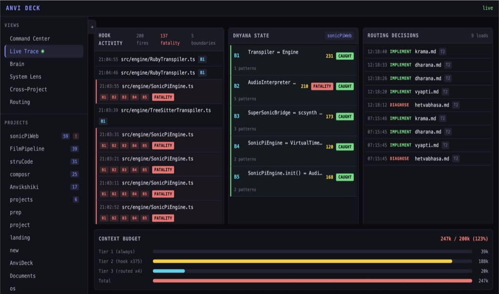

<div align="center">

# 🎛️ AnviDeck

### Cognitive framework observability deck for Ānvīkṣikī

**Watch the framework think — every catalogue, every session, every project, live and historical.**

<br>


</div>

---

> [!TIP]
> **A system that accumulates state necessarily needs observability — or that state rots undetected.** [Anvi](https://github.com/MrityunjayBhardwaj/anvi) accumulates a lot of it: four catalogues per project, dharana instantiations, per-session observations, a growing memory. AnviDeck is the instrument that makes all of it visible.

<div align="center">

</div>

## ✨ What this is

A desktop workspace for working with Claude Code agents on projects that use the [Ānvīkṣikī cognitive framework](https://github.com/MrityunjayBhardwaj/anvi). Start an agent on an issue, see what it does and what anvi told it at each step, answer it when it waits on you, review its PR with the context it had, and merge when you're satisfied. Alongside the agents sit the project's design, its notes (catalogues, memory, Ground Truth) and its history.

It began as a read-only dashboard of the framework's files, and those older views are still there (under **Older views**) until the workspace carries what's useful from them.

Agents run on your installed Claude Code and its claude.ai login, never an API key. AnviDeck itself reads the filesystem, git and the `gh` CLI. **No database, no cloud service of its own, no telemetry.**

## 🚀 Quickstart

The app is built with [Tauri](https://tauri.app). It needs [Bun](https://bun.sh) and a Rust toolchain (`rustc`, `cargo`; on macOS the Xcode command-line tools).

```bash
bun install
bun run desktop:dev     # builds the UI and the server binary, then opens the app (debug build)
bun run desktop:build   # the same, then a release AnviDeck.app under desktop/src-tauri/target/release/bundle/
```

- **How it runs:** the window shows AnviDeck's screens, and the server runs inside the app as a sidecar. Reads come from the server on a loopback port. Every action (start an agent, answer it, merge, edit a file) goes over the app's private channel to the server, never over HTTP.
- **Build output:** the UI is bundled into the app (`desktop/frontend`, made by `desktop/build-frontend.ts`), and the server is compiled with `bun build --compile` into `desktop/src-tauri/binaries/` (`desktop/build-sidecar.ts`). Neither is committed.
- **Links:** the window shows only AnviDeck's own pages, and a link to GitHub opens in your browser.
- **If the server stops:** if it can't start, or stops later, the window says so in a red bar at the top.

**In a browser, read-only.** `bun run dev` builds the UI and starts the same server alone, at `http://localhost:4000` (set `PORT` to change it). You can look at everything, but nothing sent over HTTP can make AnviDeck act, so the browser view can't start, answer or merge anything.

AnviDeck serves your session transcripts, memory and catalogues, so it answers only this machine:
- It listens on `127.0.0.1`.
- It refuses requests from other web pages, including their WebSockets.
- It refuses requests naming any host other than this machine.

Set `HOST=0.0.0.0` only if you really want other machines on your network to reach it. Other web pages are still refused.

## 🔭 The screens

| Screen | What it shows |
|------|---------------|
| 🏠 **Home** | What needs you, soonest first (permission requests answered in place, PRs with why they are or aren't ready to merge), the agents running now, and a dated health line. |
| 🗺️ **Map** | Projects, design blocks, files and imports, with agents replayed on them. |
| 🤖 **Agents** | A tab per agent and a 2×2 grid: its plan, its tool calls with the anvi hooks that ran, refusals, a message box, Stop and Resume, and a checkpoint per turn with Undo. Terminal sessions are view only. |
| 🔀 **Changes** | A PR's files, the layers and boundaries it touches, the diff with the anvi context the agent received for each file, line comments that go back to the agent, which turn changed each file, the evidence and the self-review gaps. |
| 📒 **Notes** | Catalogues by kind with search, which catalogue is used when, freshness and re-checks, grounding, and project memory with Promote. |
| 📁 **Project** | Tabs: **Code** (the file tree coloured by layer, with refused edits and files agents touched; edits only to files no running agent is touching), **Design** (five lenses on the project's design), **History** (one timeline of agent turns, edits, refusals, rulings, commits and catalogue changes), **Work** (the board, Start agent, and each PR's checks; **Merge** is a button only you press). |
| 🗄️ **Older views** | The dashboard's views from before the workspace (Live Sessions, Live Trace, Brain, System Lens, Cross-Project, Routing), until they are retired (#92). |

## 🛡️ Safety

- **This machine only**, as above.
- **Actions come only from the app's window.** Every request other than GET is refused over HTTP, on every port, and each action is written to an action log, shown in History.
- **Agents run on your Claude Code login, never an API key.** API-key variables are removed from each agent's environment, and an agent that reports anything else is stopped.
- **Your permission rules apply as in the terminal.** Only the calls they don't cover come to AnviDeck, for you to Allow or Deny. A request nobody answers keeps waiting, and a timeout never allows it.
- **Each agent runs in the permission mode you choose.** Full access is off unless you raise the cap (`ANVIDECK_AGENT_MODE_CAP`), and it then needs a confirm.
- **What is still open (#147).** Agents run as you. By default an agent's shell has your `gh` login, so it could push or merge on GitHub without AnviDeck. The **Agent GitHub access** setting can switch that to None, but it isn't airtight until agents are sandboxed. A separate bot account isn't set up yet.

The full table, with what enforces each guard and its tests, is in `CLAUDE.md` under "Safety model".

## ✅ Checks

```bash
bun test                # the test suite
bunx tsc --noEmit -p .  # types
bun run desktop:e2e     # builds a test app (with a WebDriver port), then runs the checks in its window
```

- **What the window checks cover:** every screen opens with no failed read and no script error. They also check Allow on Home, Deny with a message, Stop then Resume, a Help flow, that nothing writes over HTTP, and that the release build has no WebDriver. Release builds have no developer tools; `cargo build --features e2e` adds the WebDriver port and is never part of a normal build.
- **Agents in the checks are replays.** They play real runs recorded once (`tests/fixtures/replays`), so no Claude usage is spent. A click that answers differently from the recording fails the check, with the reason.
- **Recording:** `bun scripts/record-agent-replays.ts --check` makes one tiny real run and says whether Claude Code still sends the same shape. `--out <dir>` records again. Each recording is cleaned before it's written, and the cleaner refuses one that still names your home folder, user name, an email or a system temp folder.

## 🗺️ Architecture

- **Bun + Hono server**: lightweight, no Express.
- **Readers read, one module acts**: everything that only reads (`server/readers/*`) is kept read-only by a test. The agent host and the action log are the only code that acts.
- **Plain-TypeScript UI**: components are functions returning DOM elements. One esbuild pass (`bun run build.ts`), no webpack, no vite.
- **Tauri shell**: the window and the private channel for actions. The server is the same code as in the browser.
- **No database**: data comes from `~/.claude/`, `~/.anvideck/`, git and `gh`. AnviDeck's own records (action log, calls, agent registry, turn records) are files in its own folder.
- **Dark, monospace**: an engineering-instrument look, Grafana/Bloomberg rather than Notion.

## 🔌 Data sources

| Data | Location |
|------|----------|
| Framework principles, routing | `~/.claude/CLAUDE.md` |
| Global + project memory | `~/.claude/memory/*.md`, `~/.claude/projects/*/memory/*.md` |
| Catalogues, Ground Truth | `{project}/.anvi`, `{project}/artifacts/.anvi` or `~/.anvideck/projects/{name}/.anvi` (and `ref`) |
| Session transcripts | `~/.claude/projects/<encoded-cwd>/<session>.jsonl` |
| Live sessions | `~/.claude/sessions/*.json` |
| Hook + routing activity | `/tmp/anvi-hook-*.log`, `/tmp/anvi-route-*.log` (tailed over WebSocket) |
| Design structure | anvi's structure guard and its registries |
| Framework history | `~/.claude/.git` |
| GitHub | the `gh` CLI: PRs, issues, the board |

## 🧩 Relationship to anvi

[**anvi**](https://github.com/MrityunjayBhardwaj/anvi) is the cognitive operating system: the catalogues, hooks and reasoning discipline. **AnviDeck** is where you work with agents that run under it. It shows what anvi told each agent and why, and it never edits anvi's catalogues, memory or Ground Truth itself. A change to them is a task for an agent, which makes it as it would in a terminal.

## 📈 Status

The workspace's screens and actions are on `main`. Still open:
- the agent sandbox and a bot account (#147);
- retiring the older views (#92);
- per-hunk context on Changes (#153).

`BUILD.md` is the full specification. It says, for each part, what exists and what is planned.

## 📄 License

[GPL-3.0](LICENSE) © Mrityunjay Bhardwaj

---

<div align="center">
<sub>Companion to <a href="https://github.com/MrityunjayBhardwaj/anvi"><code>anvi</code></a> · read-heavy, write-light · observe, don't disturb</sub>
</div>
