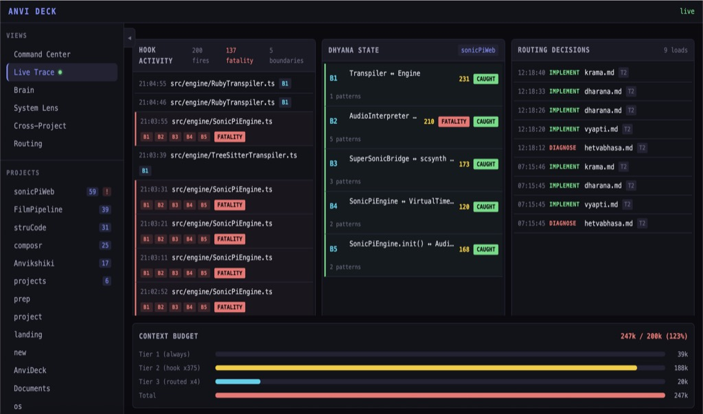

<div align="center">

# 🎛️ AnviDeck

### Cognitive framework observability deck for Ānvīkṣikī

**Watch the framework think — every catalogue, every session, every project, live and historical.**

<br>


</div>

---

> [!TIP]
> **A system that accumulates state necessarily needs observability — or that state rots undetected.** [Anvi](https://github.com/MrityunjayBhardwaj/anvi) accumulates a lot of it: four catalogues per project, dharana instantiations, per-session observations, a growing memory. AnviDeck is the instrument that makes all of it visible.

<div align="center">

</div>

## ✨ What this is

A browser-based dashboard for the [Ānvīkṣikī cognitive framework](https://github.com/MrityunjayBhardwaj/anvi). Point it at `~/.claude/` and it renders the framework operating across all projects and all sessions — in real time and historically. Open a browser, see everything, click anything, slide the timeline, and understand what led to every cognition and action.

Everything is read from the filesystem (catalogues, memory, git history, hook logs) and the `gh` CLI. **No database, no cloud, no telemetry, no API keys.**

## 🚀 Quickstart

```bash
bun install
bun run dev          # builds the UI, then starts the server
# → open http://localhost:4000
```

`bun run dev` runs a single esbuild pass (`build.ts`) and launches the [Hono](https://hono.dev) server. Set `PORT` to override the default `4000`. Requires [Bun](https://bun.sh).

## 🔭 The six views

| View | What it shows |
|------|---------------|
| 🛰️ **Command Center** | Home. Framework health, catalogue counts, fatality warnings, the session timeline — everything at a glance. |
| ⚡ **Live Trace** | Real-time cognitive trace — hook activity and routing decisions streamed over WebSocket as they fire. |
| 🔬 **System Lens** | The framework observing itself: per-session contribution matrix, catalogue growth, pruning candidates. |
| 🌐 **Cross-Project** | Pattern recognition across every project — shared error patterns, invariants, and lifecycles. |
| 🧭 **Routing** | The three-tier context architecture — what's always loaded, what the hook injected, what routing pulled in. |
| 🗂️ **Project Deep Dive** | One project up close: catalogues, memory, invariant spans, grounding status, timeline with diff mode. |

## 🗺️ Architecture

- **Bun runtime** — fast, TypeScript-native, zero-config.
- **Hono server** — lightweight, no Express.
- **Plain-TypeScript UI** — components are functions returning DOM elements. The UI is information-dense and read-heavy; a reactivity framework adds build complexity without proportional benefit.
- **No build pipeline** — a single esbuild pass via `bun run build.ts`. No webpack, no vite.
- **Filesystem-only data** — read from `~/.claude/` and the `gh` CLI. No database (the catalogue graph is small and stratified by cognitive function, not networked — tables and strata are the right representation).
- **Dark, monospace** — an engineering-instrument aesthetic. Grafana/Bloomberg, not Notion.
- **Selective DOM updates** — header, sidebar, and timeline persist across navigation; only the main content swaps. No full-page flicker.

## 🔌 Data sources

| Data | Location |
|------|----------|
| Framework principles | `~/.claude/CLAUDE.md` |
| Global + project memory | `~/.claude/memory/*.md`, `~/.claude/projects/*/memory/*.md` |
| Catalogues | `{project}/.anvi/*.md` or `{project}/artifacts/.anvi/*.md` |
| Version history | `~/.claude/.git` (log, show, diff) |
| Hook + routing activity | `/tmp/anvi-hook-*.log`, `/tmp/anvi-route-*.log` (tailed over WebSocket) |
| Active sessions | `/tmp/claude-ctx-*.json` |
| GitHub artifacts | `gh` CLI — issues, PRs, commits |

## 🧩 Relationship to anvi

[**anvi**](https://github.com/MrityunjayBhardwaj/anvi) is the cognitive operating system — the catalogues, hooks, and reasoning discipline. **AnviDeck** is its observation instrument: it doesn't change how the framework thinks, it makes the thinking legible. anvi produces the state; AnviDeck reads it.

## 📈 Status

Early but real. The data layer, REST API, Command Center, Project View, timeline, live session trace, System Lens, Cross-Project intelligence, and routing visualization are in place. Brain View, GitHub Trace, and Ground Truth visualization are in progress. See `BUILD.md` for the full specification and phase roadmap.

## 📄 License

[AGPL-3.0](LICENSE) © Mrityunjay Bhardwaj

---

<div align="center">
<sub>Companion to <a href="https://github.com/MrityunjayBhardwaj/anvi"><code>anvi</code></a> · read-heavy, write-light · observe, don't disturb</sub>
</div>
